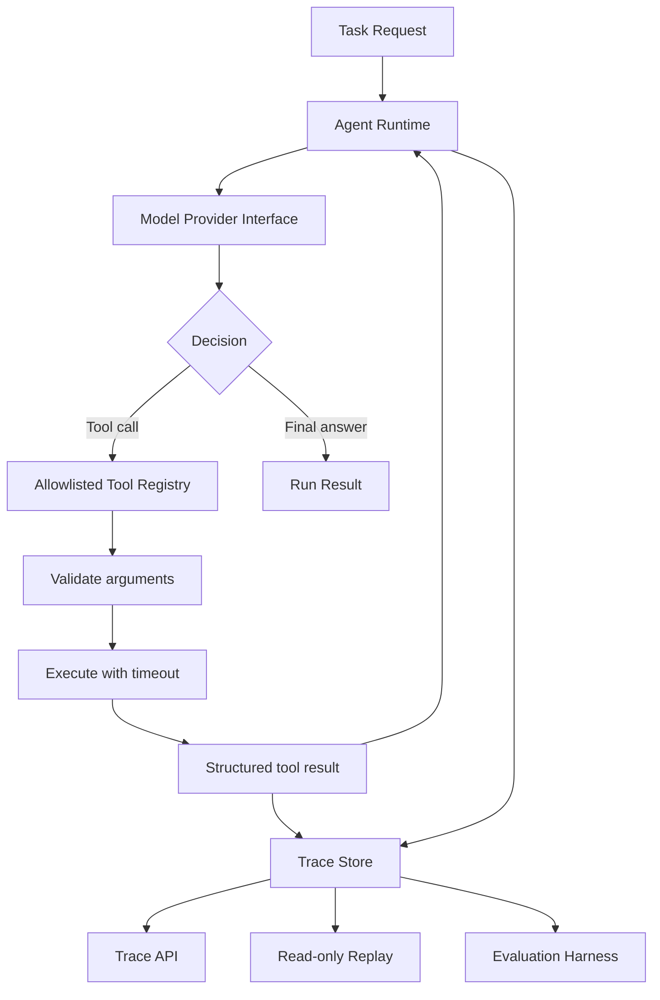

<div align="center">

# AgentTrace

### A reproducible runtime and evaluation workbench for tool-using agents.

Build, inspect, replay, and evaluate bounded agent executions — with structured traces, failure-aware tool handling, and a deterministic local benchmark.

[](https://github.com/SXZSG/agenttrace/actions/workflows/ci.yml)
[](https://www.python.org/)
[](LICENSE)
[](docs/roadmap.md)

[Quick start](#quick-start) · [Architecture](docs/architecture.md) · [中文文档](README.zh-CN.md) · [Evaluation](docs/evaluation.md) · [Roadmap](docs/roadmap.md) · [Contributing](CONTRIBUTING.md) · [Code of Conduct](CODE_OF_CONDUCT.md)

</div>

---

## 中文快速开始

AgentTrace 提供中文本地工作台。启动服务后，直接打开 `http://127.0.0.1:8001/`，即可提交自然语言任务、查看执行轨迹、读取历史记录并运行内置评测；`/docs` 保留给开发者调试 API。

Windows PowerShell：

```powershell
Set-Location .\agenttrace
.\.venv\Scripts\python.exe -m pip install -e ".[dev]"
.\scripts\run_api_windows.ps1
```

浏览器打开：

- 中文工作台：`http://127.0.0.1:8001/`
- 开发者 API 文档：`http://127.0.0.1:8001/docs`

默认使用本地 Mock 模式，无需密钥；设置 `AGENTTRACE_MODE=llm` 可启用真实模型自主工具调用。两种模式仍使用合成工具数据。请阅读[Phase 2 中文配置与安全说明](docs/llm.zh-CN.md)和[中文使用说明](docs/user-guide.zh-CN.md)。

## Why AgentTrace?

A tool-using agent can fail in more ways than returning a poor answer: it can choose an unavailable tool, emit invalid arguments, loop until a budget is exhausted, hit a timeout, or produce a result that cannot be reproduced during debugging.

AgentTrace is an engineering workbench for making those behaviors inspectable. It provides a small bounded runtime, an allowlisted tool registry, append-only execution events, a read-only replay view, and a deterministic smoke benchmark. The initial incident-triage scenario runs entirely on synthetic local data.

> **Current scope:** AgentTrace is a local agent engineering and reliability-evaluation prototype. The default provider is deterministic and scripted. An optional OpenAI-compatible Chat Completions provider supports real model decisions with bounded tool execution and checked evidence quotations. Mock benchmarks validate predefined flows, fault handling, and rule constraints; they do not establish real-LLM accuracy, semantic diagnostic correctness, or production reliability. All tool backends remain synthetic.

## What it includes

- **Bounded execution:** explicit tool allowlisting, typed argument validation, maximum-step budgets, per-tool timeouts, and controlled retries for retryable timeouts.
- **Structured traces:** ordered run events, tool inputs and outcomes, timing, error codes, and local SQLite persistence.
- **Credential-aware logging:** trace payloads redact values under common secret-related key names.
- **Read-only replay:** reconstruct a recorded sequence of tool calls and outcomes without invoking the model or re-running tools.
- **Deterministic benchmark:** run three synthetic incident cases and report task completion, expected tool-sequence matching, and required-term matching.
- **Developer interfaces:** CLI and FastAPI endpoints for runs, traces, replay, and the demo evaluation.
- **Test-first reliability checks:** tests cover tool validation, exceptions, timeouts, retry behavior, step budgets, persistence, API responses, redaction, and benchmark wiring.

## Architecture



See [the architecture notes](docs/architecture.md) for execution semantics and limitations.

## Quick start

### Requirements

- Python 3.11 or newer
- No external model API key is required for the deterministic demo

### Install

```bash
git clone https://github.com/SXZSG/agenttrace.git
cd agenttrace
python -m venv .venv
```

Windows PowerShell (recommended helper script):

```powershell
.\scripts\setup_windows.ps1
```

Or install manually:

```powershell
.\.venv\Scripts\Activate.ps1
python -m pip install --upgrade pip
pip install -e ".[dev]"
```

macOS / Linux:

```bash
source .venv/bin/activate
python -m pip install --upgrade pip
pip install -e ".[dev]"
```

### Run the local incident demo

```bash
agenttrace demo
```

Or run it as a Python module:

```bash
python -m agenttrace demo --task "Investigate the inventory service timeout incident."
```

The command prints the run record and ordered trace events. Local run data is stored in `agenttrace.sqlite3` by default. Set `AGENTTRACE_DB_PATH` to choose another path.

### Start the API

```bash
uvicorn agenttrace.api:app --host 127.0.0.1 --port 8001
```

Open the interactive API docs at `http://127.0.0.1:8001/docs`.

| Endpoint | Purpose |
|---|---|
| `GET /health` | Runtime health and provider mode |
| `GET /overview` | Read-only product overview from persisted local data |
| `POST /runs` | Execute a task using the server-configured mock or llm provider |
| `GET /runs/{run_id}` | Read a run record |
| `GET /runs/{run_id}/trace` | Retrieve ordered execution events |
| `GET /runs/{run_id}/replay` | View recorded tool calls and outcomes without re-execution |
| `POST /evaluations/demo` | Run the deterministic smoke benchmark |
| `POST /reliability/benchmark` | Run the offline versioned reliability benchmark |
| `GET /reliability/compare/{baseline_id}/{candidate_id}` | Compare compatible saved batches |

Example request:

```bash
curl -X POST http://127.0.0.1:8001/runs \
  -H "Content-Type: application/json" \
  -d '{"task":"Diagnose the checkout service incident and explain the likely root cause."}'
```

### Run tests and the smoke benchmark

```bash
pytest -q
agenttrace eval
python -m agenttrace failure-benchmark --scenario CF-04-B --strict
```

The benchmark is deliberately deterministic. A passing score means the runtime and synthetic scenario satisfy their declared checks; it is **not** a score for an LLM, and it must not be presented as one.

`--strict` is the CI-facing mode: it returns a non-zero exit code when a selected scenario is incomplete, has an evaluator error, or does not satisfy its declared rule.

## Example workflow

1. Submit a task such as “Diagnose the checkout service incident.”
2. The provider selects registered tools to read synthetic health data, error logs, recent deployments, and runbook guidance.
3. The runtime validates each call, enforces execution limits, and records outcomes.
4. Inspect the trace to see the ordered decisions and tool results.
5. Retrieve the replay view to inspect recorded tool outcomes without repeating execution.
6. Run the smoke benchmark to verify the expected tool sequence and evidence terms for checkout, payments, and inventory scenarios.

All incident data is synthetic. No production infrastructure is contacted or modified.

## Design principles

- **Explicit capabilities:** the model can request only registered tools; generated Python or shell commands are never executed.
- **Bounded work:** execution has a maximum tool-step budget and per-tool timeout.
- **Evidence over impressions:** evaluation checks declared outcomes and tool traces, not only a model-written self-assessment.
- **Observable failures:** invalid calls, timeouts, and exceptions produce structured results and trace events.
- **Honest metrics:** deterministic smoke-test results are kept separate from future real-model evaluation.
- **Local-first development:** the initial milestone works offline with synthetic data.

## Security notes

- Do not place API keys, passwords, access tokens, or confidential user data in tasks or tool arguments.
- Common credential-like keys are redacted from trace payloads, but this is a safety aid rather than a guarantee that arbitrary secrets in free text will be detected.
- Tool timeouts bound how long the runtime waits. A timed-out synchronous function running in a worker thread may continue in the background; use process isolation for untrusted or potentially blocking tools in a production deployment.
- The current API has no authentication and is intended for local development only. Do not expose it to an untrusted network.
- The included scenario is synthetic and must not be used to make operational decisions about real services.

## Project status

See the [roadmap](docs/roadmap.md). The current milestone focuses on the runtime, trace persistence, replay views, and deterministic testing. Phase 2 adds a real LLM adapter and offline protocol/failure tests. Production tool backends and cross-configuration model-quality evaluation remain future work.

## Contributing

Issues and focused pull requests are welcome. Read [CONTRIBUTING.md](CONTRIBUTING.md) and the [security policy](SECURITY.md) before contributing. Please include reproducible tests for runtime or evaluation changes.

## License

MIT. See [LICENSE](LICENSE).

## Phase 3：故障注入与可靠性评测

Phase 3 在工具执行边界提供可复现的 FaultConfig，支持 `Timeout`、`TransientError`、`PermanentError`、`EmptyResult`、`InvalidResult` 和 `ContradictoryEvidence`。默认关闭；规则只接受注册工具名和调用序号，不能执行代码或访问文件。每个运行记录注入来源、重试、阻断、冲突、预算和错误来源。回放只读取 SQLite 中的事件，不会重新调用模型、工具或故障注入器。

`src/agenttrace/scenarios.py` 提供版本化的 20 个离线场景（正常、六类故障、多工具异常、预算耗尽和 CF-01 至 CF-04 反事实对照）。`reliability.py` 使用独立证据规则评分，完成、恢复和安全终止分别统计；安全终止不计入任务完成。`evidence_quote_match_rate` 只衡量引用原文与实际工具结果的机械匹配，不能代表诊断语义正确率；自由文本 hypotheses、recommendations 和最终诊断没有独立真值时，`semantic_diagnostic_support_rate` 保持 `not_evaluated`。没有模型 token 或可核验计费数据时指标为未知。批次清单、场景规则和 grader 哈希写入 SQLite 的不可变表，只有相同场景与评分规则的完整批次才能比较。

工作台的“故障可靠性”页面只运行离线基准并展示真实保存的轨迹。API 包含 `/reliability/scenarios`、`/reliability/benchmark`、`/reliability/batches` 和批次比较相关接口。真实模型批次需要显式配置服务端 provider，并建议从受控脚本执行；页面不会把 API Key 发送到浏览器。

Windows PowerShell 5.1 使用无自动重载的稳定启动脚本：

```powershell
.\scripts\run_api_windows.ps1
# 可选：$env:AGENTTRACE_PORT = "8001"
```

完整离线检查：

```powershell
.\.venv\Scripts\python.exe -m pytest -q
.\.venv\Scripts\python.exe -m ruff check .
```

当前限制：工具后端仍是合成 incident 数据；离线策略用于验证故障边界，不能代表真实模型质量；成本和 token 只有服务返回可核验数据时才会计算；小样本批次比较是探索性结果，不表示统计显著性。

R1/R1.1 评测口径补充：规则通过表示该场景的预定义终止约束满足，不表示任务语义正确。工具错误另外拆分为注入失败与非预期失败；多故障场景分别记录每条规则的触发、未触发和部分覆盖状态，未到达的故障不计为恢复证据。R0 和 R1 原始批次保持冻结，R1.1 结果另存并带有新的 `RULE_VERSION` 与 grader hash。R1.1 允许在完整证据被独立规则检测出冲突、且 Agent 用真实双方 call_id 承认冲突并没有提出确定性假设时安全终止；虚构冲突或忽略冲突仍判错。

命令行也支持显式的真实模型批次（会产生模型服务费用，默认仍为离线）：

```powershell
# 离线，选择全部 20 个场景
.\.venv\Scripts\python.exe -m agenttrace failure-benchmark
# 真实模型，必须先配置服务端环境变量，并可先选择一个场景
$env:AGENTTRACE_MODE = "llm"
.\.venv\Scripts\python.exe -m agenttrace failure-benchmark --mode server --scenario CF-02-B
```

真实模型模式配置缺失会直接返回配置错误，不会退回 Mock。批次比较使用 `agenttrace compare-batches <baseline_id> <candidate_id>`，两批次必须具有完全相同的场景清单和评分规则。


